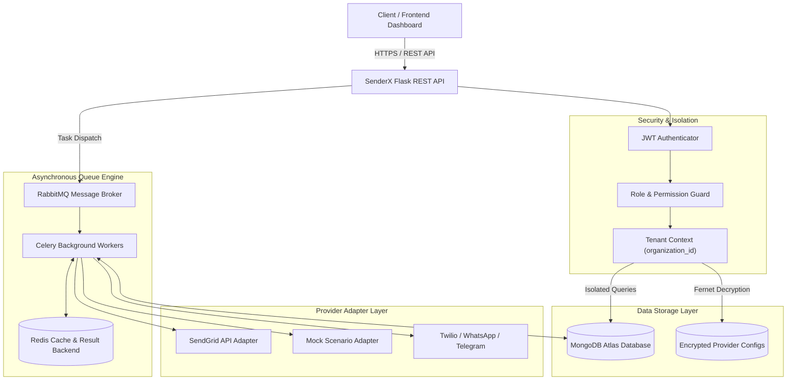
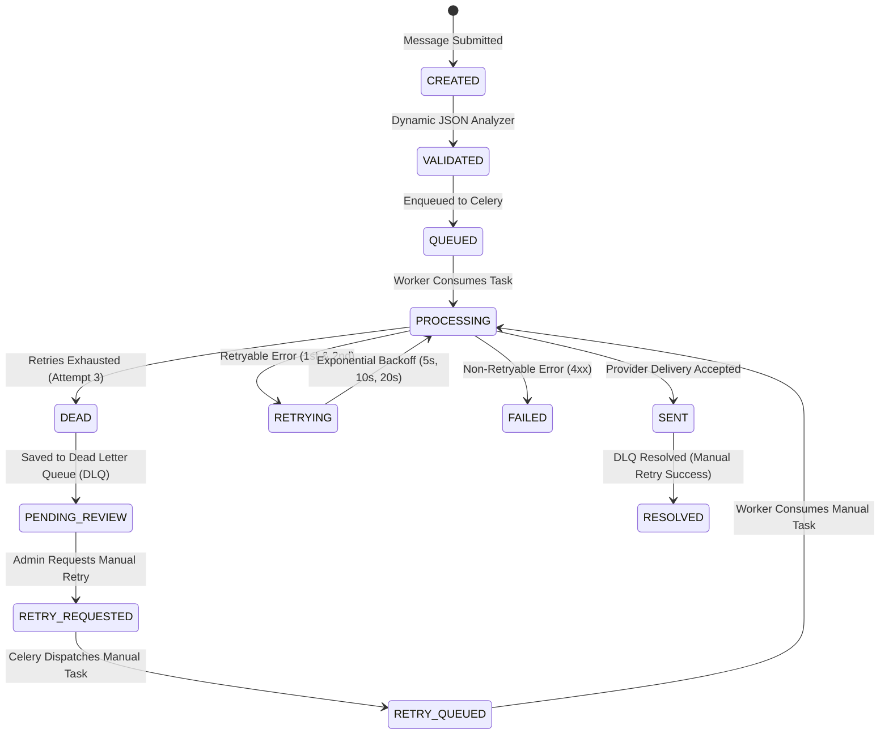

# SenderX Architecture & System Design

SenderX is an enterprise-grade, multi-tenant, multi-channel messaging platform engineered with Python Flask, MongoDB Atlas, Redis, RabbitMQ, and Celery.

---

## 1. High-Level Architecture Diagram

---

## 2. Message Lifecycle & State Machine

---

## 3. Dead Letter Queue & Manual Retry Flow

1. **Exhaustion**: When automated retries reach `MAX_RETRIES = 3`, the worker marks the message status as `DEAD` and invokes `DeadLetterRepository.save_from_message()`.
2. **Initial DLQ State**: An entry is created or updated in `dead_letters` with `dead_letter_status = "PENDING_REVIEW"` and `cycle_type = "AUTOMATIC"`.
3. **Manual Retry Trigger**: An authorized administrator triggers manual retry via `POST /api/v1/dead-letters/organization/<message_id>/retry`.
   - `mark_retry_requested()` atomically reserves the record, increments `manual_retry_count`, and pre-generates a unique `task_id`.
   - `MessageRepository.requeue_dead_message()` resets message `status = "QUEUED"` and `retry_count = 0`.
   - Celery publishes `senderx.process_message` using the exact pre-generated `task_id`.
   - `mark_retry_queued()` sets `dead_letter_status = "RETRY_QUEUED"` and `manual_retry_dispatch_state = "QUEUED"`.
4. **Resolution on Success**:
   - The worker marks message `SENT`.
   - Compares `self.request.id == dlq_record["manual_retry_task_id"]`.
   - Atomically updates DLQ to `RESOLVED` and `manual_retry_dispatch_state = "COMPLETED"`.
   - Preserves complete historical failure cycles.
5. **Re-exhaustion on Failure**:
   - If manual retry fails again, worker calls `save_from_message()`.
   - Adds a deterministic `MANUAL` failure cycle.
   - Moves DLQ back to `PENDING_REVIEW` with `manual_retry_dispatch_state = "COMPLETED"`.
   - Marks `manual_retry_history` entry as `FAILED`.
